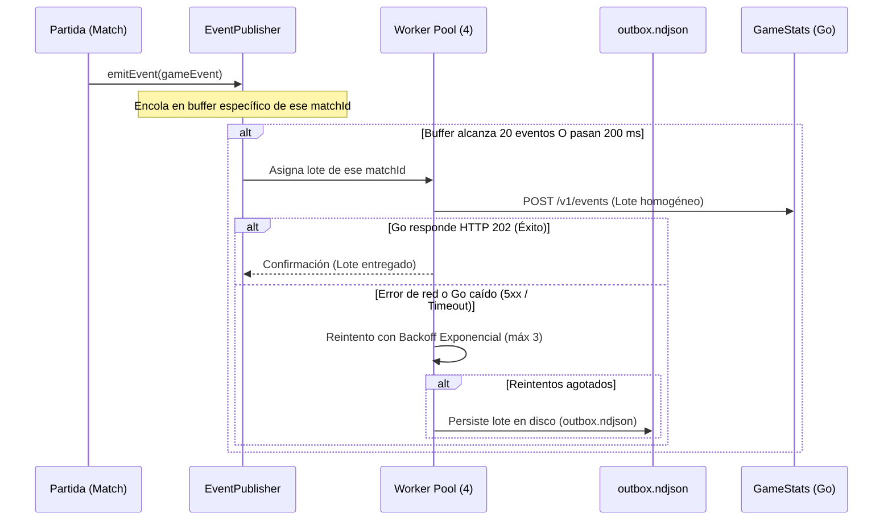

# Arquitectura Técnica de GameConsole

Documento técnico que detalla el diseño arquitectónico, el modelo de concurrencia, la estrategia de envío de eventos hacia GameStats y la toma de decisiones de la IA en Prolog.

---

## 1. Diagrama General de Componentes

```mermaid
flowchart TD
    subgraph Cliente["Capa de Presentación"]
        Browser["Navegador Web / SPA Vanilla TS<br/>(Historial, Partidas, Panel)"]
    end

    subgraph Proxy["Capa de Enrutamiento y Seguridad"]
        Caddy["Caddy Reverse Proxy<br/>(:80, :443 HTTPS Let's Encrypt / WSS)"]
        Nginx["console-web (Nginx)<br/>(Fallback SPA History API / Proxy)"]
    end

    subgraph Core["Capa de Aplicación (console-server)"]
        Fastify["Fastify HTTP / WebSocket Server"]
        Registry["GameRegistry"]
        MatchMgr["MatchManager"]
        
        subgraph Matches["Partidas Aisladas en Memoria"]
            M1["ConnectFourMatch<br/>(matchId: m-1)"]
            M2["SnakeMatch<br/>(matchId: m-2)"]
            M3["MemoryMatch<br/>(matchId: m-3)"]
        end
        
        Publisher["EventPublisher<br/>(Worker Pool = 4, Colas por matchId)"]
        OutboxFile[("Disco: outbox.ndjson")]
    end

    subgraph AI["Capa de Inteligencia Lógica"]
        Prolog["prolog-ai (SWI-Prolog HTTP :5000)<br/>(Minimax + Poda Alfa-Beta)"]
    end

    subgraph GameStatsSystem["Plataforma GameStats (Externa / GHCR)"]
        Go["gamestats-go (:8080)<br/>(Ingestión, Validación y DLQ)"]
        Scala["gamestats-scala (:8081)<br/>(Análisis Funcional y Estadísticas)"]
    end

    Browser -->|HTTPS / WSS| Caddy
    Caddy -->|HTTP / WS| Nginx
    Nginx -->|/api/* y /ws/*| Fastify
    
    Fastify --> Registry
    Fastify --> MatchMgr
    MatchMgr --> M1 & M2 & M3
    
    M1 -->|HTTP POST /decide| Prolog
    
    M1 & M2 & M3 -->|Domain Events| Publisher
    Publisher -.->|Fallo de red| OutboxFile
    Publisher -->|POST /v1/events (Lotes)| Go
    Go -->|Lotes Consolidados| Scala
    Fastify -->|GET /api/analytics/* (Proxy)| Scala
```

---

## 2. Aislamiento Concurrente: Cómo se Evita Mezclar Partidas

GameConsole atiende decenas de jugadores simultáneos en los tres juegos sin riesgo de colisión o mezcla de datos entre partidas:

1. **Identificadores UUID Semánticos Únicos:**
   - Cada partida recibe un identificador inmutable generado en el servidor con formato `m-<uuid-v4>`.
   - Cada evento de dominio lleva su propio `eventId` (`e-<uuid-v4>`), su `matchId` de origen y un `timestamp` ISO 8601 de precisión en milisegundos.
2. **Instancias de Partida Estrictamente Independientes:**
   - `MatchManager` mantiene un mapa `Map<string, Match>` en memoria. Cada objeto `Match` (`ConnectFourMatch`, `SnakeMatch`, `MemoryMatch`) encapsula su propio estado privado (tablero, serpiente, cartas ocultas, temporizadores, turnos).
   - Ninguna partida comparte variables globales ni muta estructuras de otra partida.
3. **Lotes Homogéneos de un Único `matchId`:**
   - La regla fundamental de interoperabilidad con GameStats exige que ningún lote mezcle eventos de distintas partidas.
   - `EventPublisher` clasifica los eventos entrantes en buffers independientes indexados por `matchId`. Al dispararse un envío, el lote resultante contiene **exclusivamente** eventos pertenecientes a esa partida.

---

## 3. Estrategia de Envío Concurrente de Eventos (`EventPublisher`)

El envío hacia GameStats (`POST /v1/events`) está optimizado para garantizar alto rendimiento y tolerancia a fallos:



- **Colas independientes por partida:** Cada partida acumula sus eventos en una cola privada.
- **Disparo de lotes (Flushing):** Un lote se emite de inmediato si alcanza **20 eventos**, o si transcurre un temporizador de **200 ms** (lo que ocurra primero).
- **Pool de Workers asíncronos:** Un pool de 4 workers despacha las peticiones HTTP concurrentemente sin bloquear el ciclo de juego ni los WebSockets.
- **Reintentos con Backoff Exponencial:** Ante fallas de conexión temporales, se realizan hasta 3 reintentos con retraso creciente (100 ms, 200 ms, 400 ms).
- **Outbox Persistente en Disco:** Si GameStats no responde tras los reintentos, el lote se escribe en `/data/outbox.ndjson` (montado en un volumen nombrado de Docker).
- **Reintento Periódico del Outbox:** Un temporizador cada 30 segundos lee el archivo `outbox.ndjson` e intenta reenviar los eventos pendientes en cuanto GameStats vuelve a estar operativo.
- **Apagado Ordenado (Graceful Shutdown):** Al recibir `SIGINT` o `SIGTERM`, el servidor procesa y vacía (`flushAll()`) todos los buffers pendientes antes de cerrar los procesos.

---

## 4. Motor de Inteligencia Artificial en Prolog (`prolog-ai`)

La IA de Cuatro en Línea se implementa en SWI-Prolog y se consulta vía HTTP (`POST /decide`).

### 4.1 Algoritmo Minimax con Poda Alfa-Beta
- **Poda Alfa-Beta ($\alpha$-$\beta$):** Mantiene los valores $\alpha$ (la mejor opción asegurada por el maximizador) y $\beta$ (la mejor opción asegurada por el minimizador). En el momento en que se detecta que $\beta \le \alpha$, se poda el resto del subárbol, evitando explorar miles de ramas innecesarias.
- **Orden de Exploración Heurístico (Centro hacia Afuera):**
  - Las columnas se exploran en el orden: `[3, 2, 4, 1, 5, 0, 6]`.
  - La columna central (3) ofrece la mayor cantidad de combinaciones ganadoras posibles en un tablero de 7 columnas. Al evaluar las mejores jugadas primero, se generan cortes alfa-beta tempranos de forma sistemática.
- **Profundidad según Nivel de Dificultad:**
  - **Nivel 1 (Fácil):** Profundidad 2 plies. Tiempo medio < 2 ms.
  - **Nivel 2 (Medio):** Profundidad 4 plies. Tiempo medio ~10-25 ms.
  - **Nivel 3 (Difícil):** Profundidad 6 plies. Evalúa secuencias tácticas profundas.
- **Regla Estricta:** Cuatro en Línea nunca usa jugadas aleatorias como respaldo; si Prolog no responde, se reintenta la petición HTTP o se informa el error.

---

## 5. Resumen de Decisiones de Arquitectura (ADRs)

| ADR | Tema | Decisión clave |
|---|---|---|
| ADR-001 | Framework Web | Fastify + `@fastify/websocket` por su alto rendimiento y soporte tipado. |
| ADR-002 | Identificadores | Prefijos semánticos (`m-`, `e-`, `p-`) para cumplimiento del validador de Go. |
| ADR-003 | Extensibilidad POO | Clases abstractas `Game`, `Match`, `Player` con `GameRegistry` y `MatchManager`. |
| ADR-005 | Publicación | Colas por partida, lotes temporizados (20 ev / 200 ms) y pool de 4 workers. |
| ADR-006 | Tolerancia a Fallos | Persistencia en disco `outbox.ndjson` con reenvío periódico cada 30 segundos. |
| ADR-008 | Motor Lógico | Servicio HTTP aislado en SWI-Prolog con algoritmo Minimax y poda alfa-beta. |
| ADR-011 | Contenedor Web | Nginx multi-stage sirviendo el SPA compilado y enrutando `/api/` y `/ws/`. |
| ADR-012 | Orquestación | Cadena de dependencias `condition: service_healthy` en `docker-compose.yml`. |
| ADR-014 | Producción | Caddy Reverse Proxy con certificados HTTPS automáticos y soporte de WebSockets. |
